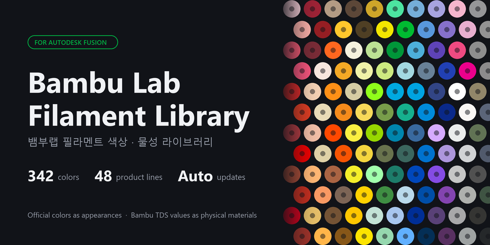

# Bambu Lab Filament Library for Autodesk Fusion

Every Bambu Lab filament in Fusion: **one appearance per official color** and **one physical material per product line** (density, modulus, strength and thermal values from Bambu's technical data sheets), added to your Fusion **Favorites**.
The script downloads Bambu's latest official color table each time it runs, so newly released filaments show up automatically.

Bambu Lab 필라멘트 전 제품의 **색상(외관)**과 **물성(물리 재질)**을 Fusion 즐겨찾기에 넣어 주는 스크립트입니다. 실행할 때마다 Bambu 공식 데이터를 받아 새 필라멘트를 자동으로 추가합니다.

- 342 colors / 48 product lines (Nov 2026): PLA, PETG, ABS, ASA, TPU, PC, PA, PET-CF, PPS-CF, PVA, supports
- Names like `Bambu PLA Basic - Jade White (제이드 화이트) [10100]` and `Bambu PLA Basic`
- Works offline with the bundled data

## Download / 다운로드

**[Latest release → BambuFilamentLibrary_x.zip](../../releases/latest)**

## Install / 설치

1. Unzip. You get a folder `BambuFilamentLibrary`. / 압축을 풀면 `BambuFilamentLibrary` 폴더가 나옵니다.
2. Copy the folder to Fusion's Scripts folder. / 폴더를 Fusion 스크립트 폴더에 복사합니다.
   - Windows: `%APPDATA%\Autodesk\Autodesk Fusion 360\API\Scripts\`
   - macOS: `~/Library/Application Support/Autodesk/Autodesk Fusion 360/API/Scripts/`
   - or in Fusion: `Shift+S` → **+** → select the folder / 또는 Fusion에서 `Shift+S` → **+** → 폴더 선택
3. In Fusion: `Shift+S` → **BambuFilamentLibrary** → **Run** → **Yes**

Run it again any time to add newly released colors. / 새 색상이 궁금하면 다시 실행하세요.

Full guides: [English](BambuFilamentLibrary/README_EN.txt) · [한국어](BambuFilamentLibrary/README_KO.txt)

## Use / 사용

- Right-click a body → **Physical Material** → `Bambu <line>` (mass, simulation / 무게·해석)
- `A` (Appearance) → drag `Bambu <line> - <color>` onto the body (look / 화면 색)

Fusion's API cannot attach a color to a physical material, so materials are per product line and colors are separate appearances. That is the normal Fusion workflow: the appearance overrides the material's look.

## Data / 데이터

| What | Source |
|---|---|
| Colors (name, hex, code) | Bambu Studio [`filaments_color_codes.json`](https://github.com/bambulab/BambuStudio/blob/master/resources/profiles/BBL/filament/filaments_color_codes.json), downloaded at run time |
| Density, modulus, strength, HDT, print temps | 35 Bambu Lab Technical Data Sheets → [`tds_all.json`](BambuFilamentLibrary/tds_all.json) |
| Lines without a data sheet | closest Bambu data sheet + Bambu Studio profile density |
| Poisson's ratio, conductivity, specific heat, CTE; PVA/support strength | typical literature values (not published by Bambu) |

Gradient/multicolor products use their first color. Hex values are screen approximations. Property values are Bambu's test values, for reference only.

## Repository layout

| Path | |
|---|---|
| `BambuFilamentLibrary/` | the Fusion script package (this folder is what the release zip contains) |
| `BambuFilamentLibrary/bambu_data.py` | downloads the color table and builds the records (plain Python, no Fusion needed) |
| `tools/update_library.py` | maintainer tool: refresh data, fetch new Bambu data sheets, rebuild the zip (`pip install -r tools/requirements.txt`) |

## License

Script code: [MIT](LICENSE). Color data is derived from Bambu Studio (© Bambu Lab, AGPL-3.0); see [NOTICE](BambuFilamentLibrary/NOTICE.md).
Unofficial project, not affiliated with Bambu Lab or Autodesk.
